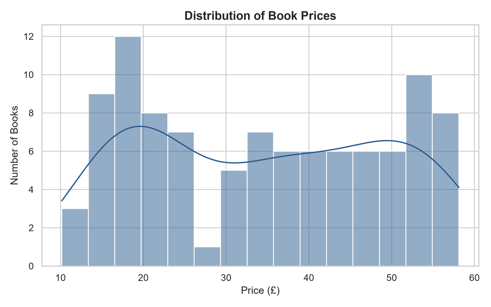
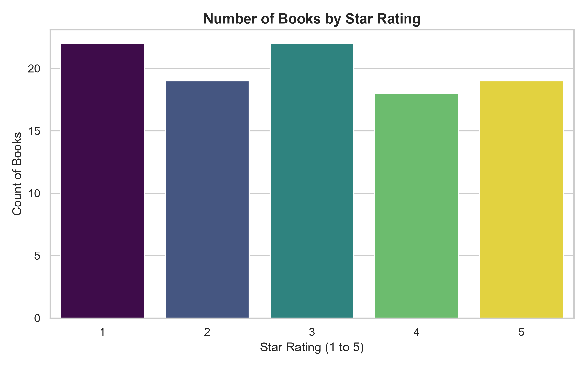
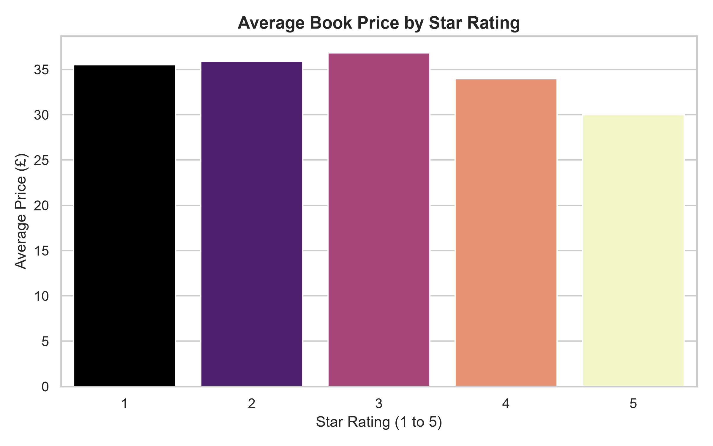
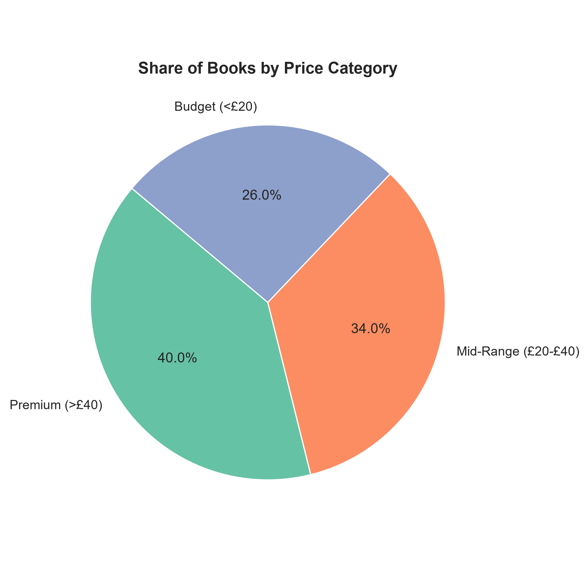

# CodeAlpha - Data Visualization

## 📌 Project Overview
This project is completed as part of the **Data Analytics Internship at CodeAlpha**. In this task, raw and processed e-commerce book data (`cleaned_books_eda.csv`) is transformed into clear, informative visualizations to communicate pricing trends, rating distributions, and product tier breakdowns.

## 🛠️ Tools & Libraries Used
- **Python 3**
- **Pandas** – For data loading and aggregation.
- **Matplotlib** – For building and exporting customized plots.
- **Seaborn** – For statistical data visualization and styling.

## 📊 Visualizations Generated

### 1. Book Price Distribution


### 2. Number of Books by Star Rating


### 3. Average Book Price by Star Rating


### 4. Share of Books by Price Category


## 📁 Project Structure
```text
CodeAlpha_DataVisualization/
│
├── cleaned_books_eda.csv         # Input dataset
├── visualize_data.py             # Python script for generating charts
├── 1_price_distribution.png      # Histogram of book prices
├── 2_rating_counts.png           # Bar chart of star ratings
├── 3_avg_price_by_rating.png     # Bar plot comparing average prices
├── 4_price_category_share.png    # Pie chart of price categories
└── README.md                     # Project documentation